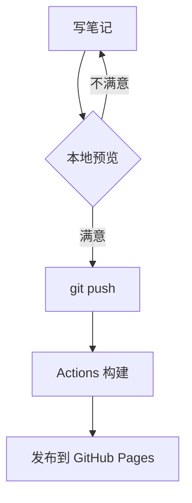
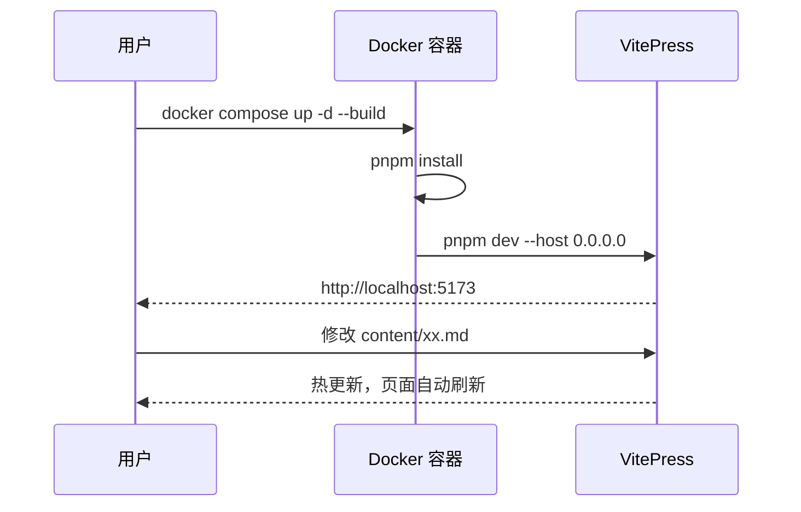
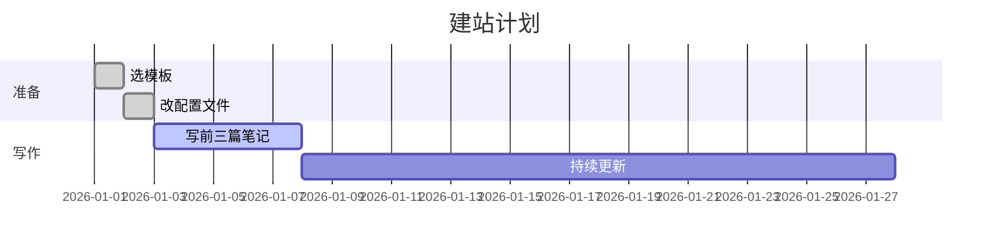
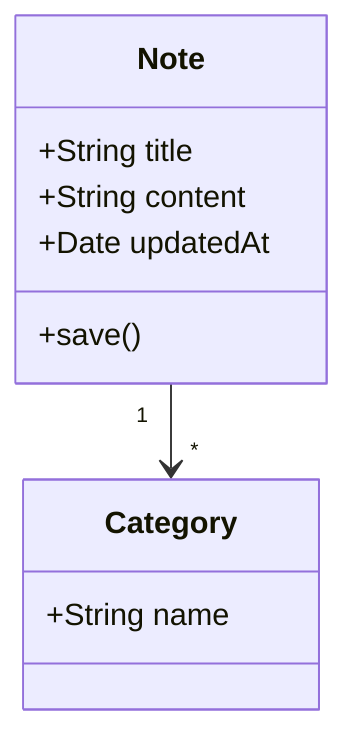

# Mermaid 图表示例

模板已内置 [vitepress-plugin-mermaid](https://github.com/emersonbottero/vitepress-plugin-mermaid)，
直接写 ` ```mermaid ` 代码块即可渲染，不需要额外配置。

::: tip 语法
代码块语言标记写 `mermaid`，第一行声明图表类型（`flowchart`、`sequenceDiagram`、`gantt` 等）。
:::

## 流程图

````md

````

效果：


## 时序图



## 甘特图



## 类图



::: warning 图表里别用特殊符号
Mermaid 对 `()`、`[]`、`{}`、`;` 等字符敏感，节点文字里有特殊符号时用双引号包起来：
`A["文字（含括号）"] --> B`。
:::
